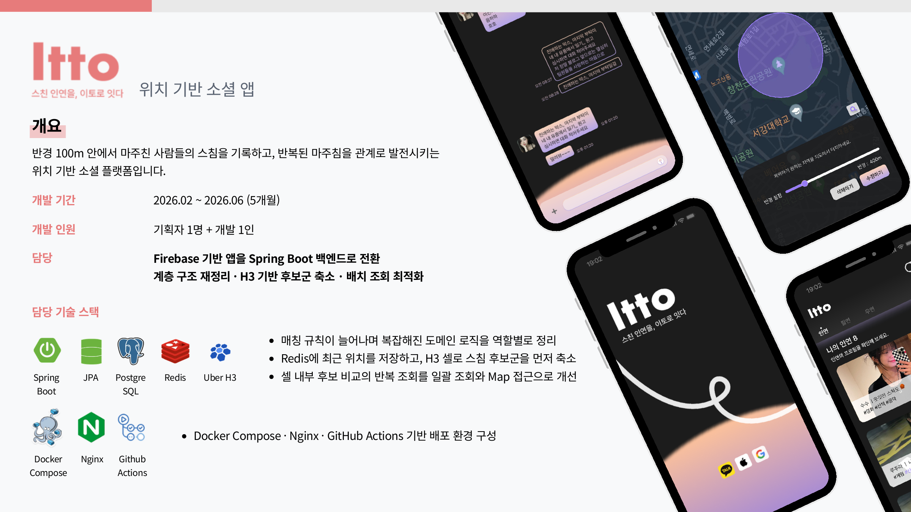

<h1 align="center">ITTO Mobile</h1>

<p align="center">
  스쳐 간 사람을 다시 연결하는 위치 기반 인연 서비스의 Flutter 앱
</p>

<p align="center">
  
  
  
  
</p>



## 프로젝트 개요

| 항목 | 내용 |
|---|---|
| 기간 | 2026.02 ~ 2026.06 |
| 구성 | 기획 1명 · 개발 1명 |
| 담당 | Flutter 앱 전체 구현 · 백엔드 API 연동 |
| 주요 기능 | 소셜 로그인, 백그라운드 위치 기록, 인연 탐색, 채팅, 알림, 프로필·설정 |

관련 저장소: [Backend](https://github.com/kr-Uk/itto-backend) · [Server](https://github.com/kr-Uk/itto-server)

## 기술 스택

- 상태·라우팅: Riverpod · GoRouter
- 네트워크: Dio · Retrofit
- 지도·위치: Naver Map · Background Geolocation
- 인증: Google · Kakao · Apple 로그인
- 채팅·알림: Cloud Firestore · Firebase Storage · Firebase Messaging
- 로컬 보안 저장소: Flutter Secure Storage

## 앱 구조

```text
lib/
├── core/          # 네트워크, 라우팅, 의존성 주입, 공통 설정
├── data/          # 원격 데이터 소스와 저장소 구현
├── domain/        # 엔티티, 저장소 인터페이스, 유스케이스
└── presentation/  # 화면과 Riverpod 상태
```

서버가 인증과 관계 상태를 판단하고, 앱은 위치 권한·백그라운드 수집과 사용자 화면에 집중합니다.

## 실행 준비

```bash
cp .env.example .env
flutter pub get
flutter run
```

`.env`에는 공개 가능한 API URL과 클라이언트 ID만 둡니다. 서버 비밀값은 백엔드에서 관리합니다.

Transistorsoft 위치 SDK 라이선스는 저장소 밖에서 빌드 시 제공합니다.

- Android 릴리스: 환경 변수 `BG_GEO_LICENSE`
- iOS 릴리스: Git에서 제외된 `ios/Flutter/BackgroundGeolocation.xcconfig`
- Debug 빌드: 라이선스 없이 실행 가능

## 저장소 상태

프로젝트 종료 시점의 코드를 포트폴리오용으로 공개한 읽기 전용 저장소입니다.
